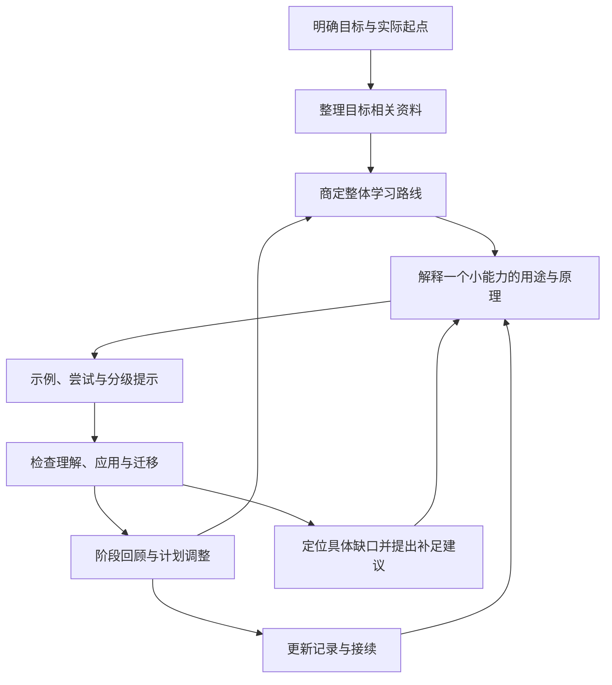

# AI 学习工作流

一套面向新领域学习者的 AI 带教流程：了解目标与基础，结合可靠资料制定计划，以小能力为单元讲解和练习，依据实际表现调整，并用结构化记录支持长期学习。

主要面向进入新专业或领域的成年人，也适用于高中及以上、能够思考并反馈自身学习情况的学生。学习内容可以是职业技能、学科知识或具体方法，不限定编程或 AI 开发。

本仓库提供流程、导师指令和 Markdown 模板，可供个人学习者、教学设计者及教学 Agent 开发者使用。无需运行程序。

## 从这里开始

1. 阅读 [完整工作流](WORKFLOW.md)，了解阶段关系和调整规则。
2. 将 [导师执行指令](prompts/TUTOR.md) 和完整工作流提供给所使用的 AI。
3. 说明学习目标、已有经历、可投入时间与现有材料。AI 先做必要诊断，再给出可修改的路线。
4. 按 [学习总清单](templates/LEARNING_PLAN.md)、[当前接续页](templates/CURRENT_STATE.md) 和 [阶段记录](templates/STAGE_RECORD.md) 保存学习进展。
5. 更换会话时提供最新总清单与当前接续页，需要核实时再提供对应阶段记录。

能够读写文件的系统可以直接维护这些材料。普通对话环境可由 AI 输出更新内容，再由学习者携带到新会话；实际保存方式取决于所用系统，不能仅凭提示词保证跨会话记忆。

## 工作流程

图中箭头表示推荐关系。发现缺口不等于强制停课：AI 说明影响，学习者决定补足、暂缓或调整顺序，记录如实保留。

## 核心约定

- **先了解人，再安排内容**：结合目标、条件和具体表现判断起点；初始画像随学习过程修正。
- **先讲整体，再小步实践**：说明为什么学、学到什么程度、过程怎样连接，再进入当前任务。
- **以完整小能力为单元**：控制跨度，同时避免把学习拆成重复、琐碎的操作确认。
- **帮助逐步调整**：新知识可以完整示范，已学内容的练习先尝试，遇到卡点逐级提示。
- **检查能力，减少输入负担**：解释、选择、操作或作品检查按内容选用，公式可以用含干扰项的选择形式。
- **如实记录证据**：听懂、提示后完成、自行完成相近任务和迁移表现分别记录。
- **学习者决定顺序**：AI 可以指出不合理之处并解释理由；学习者了解后仍坚持，就据此调整。
- **复习有目的，也可拒绝**：阶段回顾、中断恢复、反复错变式及新旧知识关联采用不同处理。
- **资料有依据，计划可更新**：重要要求保留来源与适用范围，不因热点盲目扩大任务。
- **新会话能恢复具体动作**：整体路线、当前状态和历史依据各有明确位置。

## 文件导航

| 文件 | 内容 |
| --- | --- |
| [WORKFLOW.md](WORKFLOW.md) | 八阶段流程、帮助尺度、检查方式、复习与调整规则 |
| [prompts/TUTOR.md](prompts/TUTOR.md) | 可交给 AI 执行的导师指令 |
| [templates/LEARNING_PLAN.md](templates/LEARNING_PLAN.md) | 学习目标、阶段关系与逐阶段清单 |
| [templates/CURRENT_STATE.md](templates/CURRENT_STATE.md) | 当前有效状态与下一步动作 |
| [templates/STAGE_RECORD.md](templates/STAGE_RECORD.md) | 练习表现、提示、错误与检查依据 |
| [templates/RESOURCE_REGISTER.md](templates/RESOURCE_REGISTER.md) | 资料来源、适用范围及更新影响 |
| [examples/CAREER_TRANSITION.md](examples/CAREER_TRANSITION.md) | 成年人进入数据分析领域的虚构示例 |
| [examples/FORMULA_LEARNING.md](examples/FORMULA_LEARNING.md) | 含公式的学科学习与选择式检查示例 |
| [docs/DESIGN.md](docs/DESIGN.md) | 设计原则、取舍与执行者职责 |
| [docs/VALIDATION.md](docs/VALIDATION.md) | 文档检查范围、场景走查与局限 |

## 如何用于教学系统

将完整工作流作为教学行为约定，导师指令用于落实每轮活动，模板字段用于组织学习状态。教学系统需要根据实际权限实现资料读取、记录保存和会话恢复。

学习主题改变时，替换目标相关资料、具体任务和检查内容；保留诊断、分级帮助、证据区分、学习者选择及接续规则。

可先参考两个虚构示例走完整流程，再使用自己的学习材料试用。示例展示流程怎样运作，不代表真实学习效果。

## 范围与验证

当前版本为 `v1.0.0`，覆盖流程说明、可复用模板及文档场景走查。它没有内置课程库、自动搜索、自动批改或存储服务；这些能力取决于执行系统。

选择题答对、任务完成或课程结束都不能单独证明全面掌握。工作流没有经过真实学习者效果实验，也不承诺固定学习周期、成绩、就业或特定教育效果。
